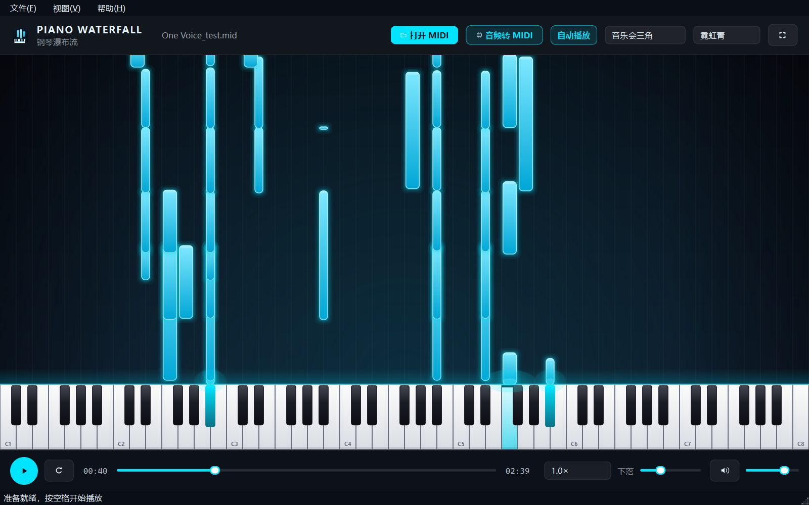
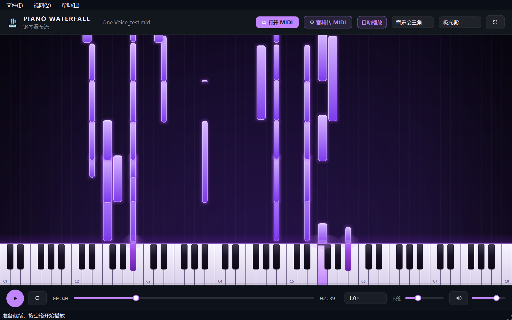
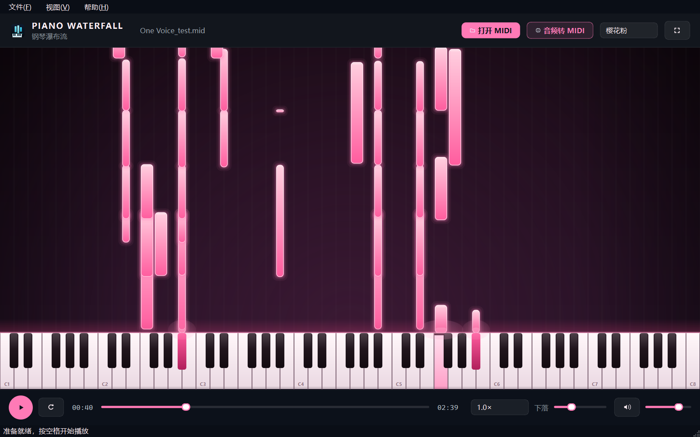

# Piano Waterfall · 钢琴瀑布流

把 MIDI 文件或钢琴录音变成一场下落的霓虹音符雨。



<p align="center">
  
  
  
  
  <a href="https://github.com/Dream-Alan/piano-waterfall/actions/workflows/tests.yml">
    
  </a>
</p>

Piano Waterfall 是一个用 PySide6 写的桌面播放器：打开 `.mid` 文件，它会用内置的真实钢琴采样渲染音频，
同时绘制 Synthesia 风格的瀑布流。不需要 SoundFont、不需要联网、首次渲染后自动缓存，之后打开同一首曲子几乎是瞬时的。

如果只有 MP3 / WAV 录音，也可以直接用内置的 hFT-Transformer 转录成 MIDI，再播放。

---

## 功能

- **真实钢琴采样**：内置 26 个根音（A1–C8，每三个半音一个）的三角钢琴采样，运行时按音高带限重采样，
  完全离线，不用 SoundFont。
- **5 种音色**：音乐会三角、明亮流行、毛毡柔音、复古立式、近场录音，通过均衡、滤波、混响与延迟塑造，
  顶部下拉框即时切换，按音色分别缓存，切换后自动回到原播放位置。
- **瀑布流动画**：霓虹音符、按键高亮、粒子、判定线，支持 5 套主题与彩虹音符。
- **播放控制**：播放 / 暂停、重播、拖动进度、0.5–1.5× 倍速、音量与静音。
- **自动播放开关**：顶栏「自动播放」可随时打开或关闭，打开 MIDI / 音频后是否立即播放由它决定，设置会记住。
- **全屏模式**：F11 或双击画面，适合投屏和练琴。
- **拖放打开**：把 MIDI 或音频直接拖进窗口。
- **内置音频转 MIDI**：随程序附带 [hFT-Transformer](https://github.com/sony/hFT-Transformer)
  的 22 MB ONNX 模型，CPU 本地推理，不需要安装 PyTorch，也不上传音频；模型缺失时可在面板里一键重新下载。
- **跨平台**：Windows、macOS、Linux，同一套代码。

## 快速开始

### 方式一：下载 Windows 免安装版

1. 打开 [Releases](https://github.com/Dream-Alan/piano-waterfall/releases) 下载
   `PianoWaterfall-windows-x64.zip`。
2. 解压到任意目录，双击 `PianoWaterfall.exe`。
3. 首次运行若出现 SmartScreen 提示，选择「更多信息 → 仍要运行」。

### 方式二：从源码运行

需要 Python 3.10 或更高版本。

```bash
git clone https://github.com/Dream-Alan/piano-waterfall.git
cd piano-waterfall

python -m venv .venv
# Windows
.venv\Scripts\activate
# macOS / Linux
source .venv/bin/activate

pip install -e .
piano-waterfall
```

也可以直接：

```bash
python -m piano_waterfall path/to/song.mid
piano-waterfall path/to/song.mid --fullscreen
piano-waterfall path/to/song.mid --voice felt
piano-waterfall --transcribe recording.mp3 --out song.mid
piano-waterfall --version
```

### 音频转 MIDI

无需额外安装。打开主界面的「音频转 MIDI」面板，选择 MP3 / WAV / FLAC 等文件即可；
模型随程序一起分发，转录在本机 CPU 上完成。转录结果保存在应用数据目录里，完成后会自动打开。

## 使用说明

| 操作 | 快捷键 |
| --- | --- |
| 播放 / 暂停 | `空格` |
| 全屏切换 | `F11` 或双击画面 |
| 退出全屏 | `Esc` |
| 打开 MIDI 或音频 | `Ctrl+O` |
| 音频转 MIDI 面板 | `Ctrl+T` |
| 彩虹音符 | `Ctrl+R` |
| 退出 | `Ctrl+Q` |
| 查看快捷键 | `F1` |

- 下拉框切换主题，右侧滑杆调整音符下落速度，倍速框调整播放速度。
- 顶部音色框可切换 `grand` 音乐会三角、`bright` 明亮流行、`felt` 毛毡柔音、`upright` 复古立式、
  `room` 近场录音；换音色会沿用当前进度，重新渲染一次并单独缓存。
- 顶栏「自动播放」开关控制打开文件后是否立即开始；关闭时只加载画面，按空格再播放。
- 命令行可用 `--voice grand|bright|felt|upright|room` 指定初始音色。
- 转录面板显示内置模型状态；如果模型文件损坏或缺失，点「一键下载 AI 模型」即可修复，不需要装依赖。
- 数据（音频缓存、转录出的 MIDI、设置）默认保存在：
  - Windows：`%LOCALAPPDATA%\PianoWaterfall`
  - macOS：`~/Library/Application Support/PianoWaterfall`
  - Linux：`~/.local/share/PianoWaterfall`
- 想做成便携版，可设置环境变量 `PIANO_WATERFALL_DATA_DIR` 指向任意目录。

## 主题

<p align="center">
  
  
  
</p>

内置主题：霓虹青 `neon`、极光紫 `aurora`、琥珀金 `amber`、樱花粉 `sakura`、经典蓝 `classic`。
主题定义在 `src/piano_waterfall/theme.py`，新增一套只需要加一个 `Theme(...)`。

## 工作原理

| 阶段 | 实现 |
| --- | --- |
| 解析 MIDI | `mido` 按绝对 tick 累加，处理延音踏板（CC64）、未闭合音符与打击乐通道 |
| 键盘布局 | 根据音域自动补全到 C 边界，白键等宽、黑键居中偏窄，绘制范围限制在 A0–C8 |
| 音频渲染 | 26 个真实钢琴根音采样（A1–C8），按音高做带限 FFT 重采样；每种音色再叠加低通/高架/临场均衡、混响与延迟 |
| 播放 | `QMediaPlayer` 播放 WAV；`PlaybackClock` 用 50 ms 位置回报 + 单调时钟插值，暂停/拖动/倍速都保持同步 |
| 画面 | `QPainter` 每帧绘制背景光晕、音符渐变、粒子、判定线与按键 |

音频缓存位于应用数据目录的 `audio-cache/`，以 MIDI 路径、大小、修改时间和合成参数做指纹；
修改参数或缓存版本会生成新的缓存文件。

## 项目结构

```text
piano-waterfall/
├─ CHANGELOG.md
├─ src/piano_waterfall/
│  ├─ app.py          主窗口、菜单、播放控制、转录面板
│  ├─ waterfall.py    瀑布流绘制（QPainter）
│  ├─ synth.py        钢琴采样渲染、音色处理与 WAV 写出
│  ├─ samples.py      采样库加载、音高映射与带限重采样
│  ├─ midi_io.py      MIDI 解析、延音踏板、音符工具
│  ├─ layout.py       键盘几何布局
│  ├─ player.py       播放时钟与 QMediaPlayer 封装
│  ├─ hft.py          hFT-Transformer ONNX 推理、mel 前端、音符解码
│  ├─ transcribe.py   音频转 MIDI 的统一入口（兼容旧 API）
│  ├─ theme.py        5 套主题配色
│  ├─ style.py        Qt 深色样式表
│  ├─ icons.py        矢量图标
│  └─ paths.py        应用数据目录与缓存
├─ src/piano_waterfall/assets/samples/  钢琴采样与授权说明
├─ src/piano_waterfall/assets/models/   hFT-Transformer ONNX 模型与授权说明
├─ tests/             pytest 单元测试（离屏 Qt）
├─ scripts/           截图、图标、Windows 打包、GitHub 推送脚本
├─ packaging/         PyInstaller spec 与启动器
├─ docs/              README 截图
└─ .github/workflows/ 测试与 Release 工作流
```

## 开发

```bash
pip install -e ".[dev]"
python -m pytest          # 46 个测试，Qt 使用 offscreen 平台
python -m ruff check .
```

重新生成截图：

```bash
python scripts/screenshot_app.py song.mid docs/screenshot-neon.png --time 40 --theme neon
```

## 打包与发布

### 本地打包 Windows 免安装版

```powershell
powershell -ExecutionPolicy Bypass -File scripts\build_windows.ps1
```

产物：`dist/PianoWaterfall/PianoWaterfall.exe` 和 `release/PianoWaterfall-windows-x64.zip`。

### 发布到 GitHub

先在 GitHub 新建一个**空仓库**（不要勾选 README / .gitignore），然后：

```powershell
powershell -ExecutionPolicy Bypass -File scripts\publish_github.ps1 `
  -RepoUrl https://github.com/Dream-Alan/piano-waterfall.git -Tag v1.3.0
```

脚本会初始化仓库、提交、推送 `main` 和 `v1.3.0` 标签；标签会触发
`.github/workflows/release.yml` 自动构建 Windows zip 并创建 Release。
如果仓库名或用户名不同，把上面的地址和项目里的 `Dream-Alan` 一起替换掉即可。

## 常见问题

**第一次打开一首 3 分钟的曲子要等几秒？**
需要把几千个音符逐个混进一条完整音轨，现代 CPU 大约 3–8 秒；完成后写入缓存，下次打开即可秒开。
窗口中央会显示渲染进度。

**没有声音？**
先检查顶栏「自动播放」是否打开（关闭时打开文件不会自动播放，按空格即可）；
再检查系统音量和右下角音量滑杆。如果状态栏提示渲染失败，通常是磁盘空间不足或缓存目录不可写，
可以设置 `PIANO_WATERFALL_DATA_DIR` 换一个可写目录。

**觉得音色太亮 / 太闷？**
顶部音色框换一个预设试试：毛毡柔音更安静温暖，明亮流行更清脆，复古立式带一点木箱和走音感，
近场录音更干、更有颗粒。换音色后需要重新渲染一次，进度条会显示在画面上。

**Windows 提示「已保护你的电脑」？**
这是未签名程序的 SmartScreen 提示，选择「更多信息 → 仍要运行」即可。

**音频转 MIDI 失败？**
面板顶部会显示模型状态；如果模型缺失或损坏，点「一键下载 AI 模型」重新获取（约 22 MB）。
MP3 解码依赖 libsndfile，若遇到不支持的编码，可先转成 WAV 再试。转录较长的录音时请留出
大约音频时长 1–2 倍的时间，CPU 型号越新越快。

**Linux 启动报 Qt 平台插件错误？**
安装 `libegl1`、`libxkbcommon-x11-0`、`libxcb-cursor0` 等依赖，或在无显示器环境使用
`QT_QPA_PLATFORM=offscreen`。

## 致谢

- [hFT-Transformer](https://github.com/sony/hFT-Transformer)（Sony，MIT）提供高精度钢琴转录
  模型；本项目把官方 checkpoint 导出为 ONNX，并用 ONNX Runtime 在本地运行。
- [tonejs-instruments](https://github.com/nbrosowsky/tonejs-instruments) 提供钢琴采样，
  原始录音来自 **VSCO 2 Community Edition**（Versilian Studios），采样以 **CC-BY 3.0** 授权；
  本项目做了裁剪、单声道化、重采样与响度归一化，详见
  [`assets/samples/ATTRIBUTION.md`](src/piano_waterfall/assets/samples/ATTRIBUTION.md)。
- [mido](https://mido.readthedocs.io/) 负责 MIDI 读写，[numpy](https://numpy.org/) 负责采样重采样与混音，
  [ONNX Runtime](https://onnxruntime.ai/) 负责本地推理，[libsndfile](https://libsndfile.github.io/libsndfile/)
  经 [soundfile](https://python-soundfile.readthedocs.io/) 解码音频。
- [Qt for Python](https://doc.qt.io/qtforpython/) 提供窗口、多媒体与绘制能力。
- 视觉灵感来自 Synthesia 的瀑布流。

## License

[MIT](LICENSE) © 2026 Piano Waterfall contributors

---

## English summary

Piano Waterfall is a desktop player that turns MIDI files (or piano recordings) into a neon
Synthesia-style waterfall. It parses MIDI with `mido`, renders a piano track offline from 26 real
grand-piano samples (A1–C8) with per-note band-limited resampling, applies one of five tone presets
(EQ, filtering, reverb and delay), caches the rendered WAV per voice, and draws the animation with
PySide6 / QPainter. An auto-play toggle decides whether a freshly opened file starts immediately.
Optional AI transcription is built in: a 22 MB hFT-Transformer ONNX model runs locally on the CPU
through ONNX Runtime, so MP3/WAV recordings can be converted to MIDI without installing PyTorch or
uploading audio. Five themes, fullscreen mode, drag & drop, speed control and keyboard shortcuts are
included.
Build a standalone Windows executable with `scripts/build_windows.ps1`; tagged pushes trigger a
GitHub release workflow. The application is MIT-licensed; the piano samples are CC-BY 3.0 (VSCO 2
CE via tonejs-instruments).
